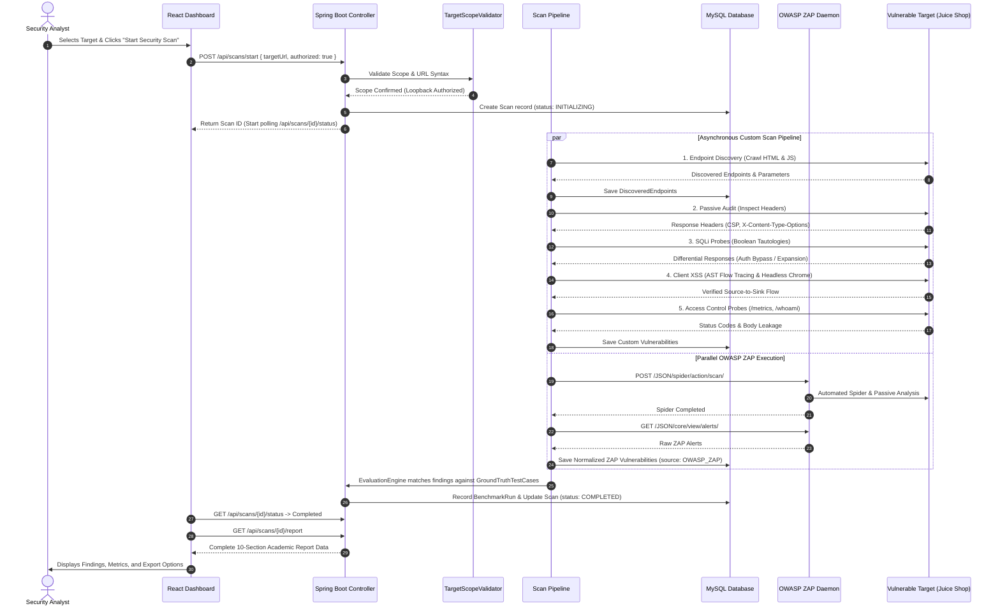
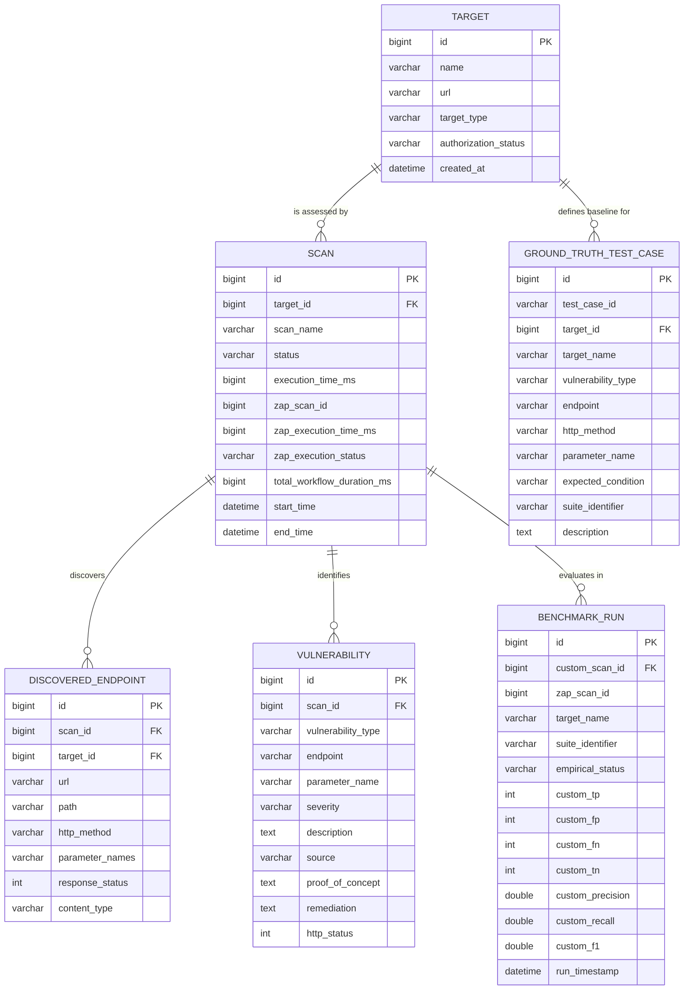

# CYBER-19 — Architecture, Engineering & Project Overview

> **Project Title:** CYBER-19 — Automated Web-Application Vulnerability Assessment Platform  
> **Course / Context:** Semester VII Capstone Project (CP1)  
> **Repository:** [https://github.com/SHAIKZILANI/CYBER-19](https://github.com/SHAIKZILANI/CYBER-19)  
> **Target Audience:** Project teammates, technical evaluators, and academic defense reviewers.

---

## Table of Contents
1. [Executive Summary & Purpose](#1-executive-summary--purpose)
2. [Problem Statement & Scientific Gap](#2-problem-statement--scientific-gap)
3. [Key Project Objectives](#3-key-project-objectives)
4. [System Architecture](#4-system-architecture)
5. [Technology Stack & Rationale](#5-technology-stack--rationale)
6. [Component Responsibilities](#6-component-responsibilities)
7. [End-to-End Data Flow](#7-end-to-end-data-flow)
8. [Database Schema & Entity Model](#8-database-schema--entity-model)
9. [Defensive Security & Scope Boundaries](#9-defensive-security--scope-boundaries)
10. [Chronological Implementation History (Phases 1–17)](#10-chronological-implementation-history-phases-117)
11. [Multi-Target Benchmark Matrix & Ground Truth](#11-multi-target-benchmark-matrix--ground-truth)
12. [Known Limitations & Scope Constraints](#12-known-limitations--scope-constraints)
13. [Future Development Roadmap](#13-future-development-roadmap)
14. [Documentation & Script Index](#14-documentation--script-index)

---

## 1. Executive Summary & Purpose

**CYBER-19** is an automated, non-destructive web application vulnerability assessment platform engineered for rigorous defensive security evaluation. It eliminates the reliance on synthetic mocks and destructive fuzzing by integrating:

1. **Autonomous attack surface discovery** via HTML/DOM parsing and JavaScript AST script mining.
2. **Controlled differential SQL Injection analysis** detecting authentication bypasses and database logic alterations.
3. **Client-side DOM XSS detection** combining static Abstract Syntax Tree (AST) source-to-sink flow tracing with dynamic headless Chrome sink interception.
4. **Passive security posture auditing** verifying critical HTTP transport security and Content Security Policy (CSP) headers.
5. **Automated access control & IDOR detection** validating permission enforcement across sensitive endpoints without credential leakage.
6. **Side-by-side comparative benchmarking** orchestrating OWASP ZAP 2.17.0 over REST APIs and measuring mathematical precision, recall, and F1-score against 58 authentic ground-truth test cases across three distinct application architectures (OWASP Juice Shop, OWASP WebGoat, and DVWA).
7. **Academic security assessment reporting** delivering executive summaries, empirical findings with reproducible HTTP payloads and responses, remediation roadmaps, and one-click JSON/CSV dataset exports.

---

## 2. Problem Statement & Scientific Gap

Modern web security scanning faces three acute challenges in academic research and industrial defense:

1. **High False Positive Rates in Dynamic Application Security Testing (DAST):**  
   Commercial and open-source scanners frequently trigger noisy false alarms on benign error pages, generic 500 status codes, or client-side redirects, creating fatigue for security analysts.
2. **Client-Side SPA Blind Spots (Single-Page Application DOM XSS):**  
   Modern applications built on Angular, React, and Vue execute routing, templating, and view-state rendering client-side. Traditional HTTP crawling engines fail to detect DOM-based Cross-Site Scripting when untrusted inputs flow directly from browser properties (`location.search`, `hash`) into DOM sinks (`innerHTML`, `bypassSecurityTrustHtml`) without transmitting network payloads to the backend server.
3. **Absence of Deterministic Empirical Ground-Truth Benchmarking:**  
   Most vulnerability scanners do not provide built-in mathematical verification engines that evaluate detection results against an authentic, deterministic ground-truth suite. As a result, claims of scanning efficacy often lack formal scientific validity (Precision, Recall, F1-Score, and False Positive Rate).

### The CYBER-19 Solution
CYBER-19 bridges this gap by coupling autonomous crawling, differential payload verification, client AST flow tracing, headless browser canary execution, and dual-scanner benchmarking evaluated against verified ground truth.

---

## 3. Key Project Objectives

- **Autonomous Discovery:** Crawl applications dynamically to discover paths, forms, query parameters, and REST routes up to configurable recursion depths without pre-seeded lists.
- **Safe Differential SQLi:** Inject non-destructive boolean tautologies (`' OR '1'='1'--`) and measure structural HTTP response differentials (e.g., authentication token emission or body byte expansion) with zero database corruption.
- **Client-Side AST XSS Tracing:** Statically parse client JavaScript bundles (`main.js`) to trace input sources (`queryParams.q`) into dangerous sanitization bypass sinks.
- **Dynamic Headless Browser Sink Interception:** Instrument Google Chrome DOM sinks (`innerHTML`, `document.write`) via `puppeteer-core` to verify DOM XSS execution in real-time within strict loopback boundaries.
- **Access Control & IDOR Verification:** Verify access boundaries on privileged telemetry (`/metrics`), user profile models, and protected REST routes.
- **Comparative Baseline Benchmarking:** Trigger OWASP ZAP 2.17.0 in baseline mode via its REST API, normalize findings, and calculate formal confusion matrices.
- **Academic Reproducibility:** Persist all telemetry, request payloads, response differentials, and ground-truth classifications in MySQL 8, enabling one-click RFC-4180 CSV and JSON scientific exports.

---

## 4. System Architecture

CYBER-19 is organized into four decoupled architectural tiers:

```mermaid
graph TD
    subgraph Tier1["Tier 1: Presentation Layer (Port 5173)"]
        UI["React 18 + Vite SPA Dashboard"]
        Views["Dashboard | New Scan | Report | Metrics | Research | CP1 Defense"]
    end

    subgraph Tier2["Tier 2: Orchestration & Application Layer (Port 8081)"]
        SpringBoot["Spring Boot 3.3.4 (Java 21 LTS)"]
        
        subgraph DetectionEngines["Vulnerability Detection Engines"]
            Crawler["EndpointDiscoveryService<br/>(Crawler & Route Extractor)"]
            PassiveAudit["PassiveSecurityAuditService<br/>(Headers & Transport)"]
            SQLiEngine["SqlInjectionDetectionService<br/>(Boolean Differential Probes)"]
            XSSEngine["XssDetectionService<br/>(AST Client Flow Analysis)"]
            BrowserDOM["BrowserDomXssDetectorService<br/>(Headless Chrome Sinks)"]
            AccessControl["AccessControlDetectionService<br/>(BAC & IDOR Assessment)"]
            Remediation["RemediationGuidanceService<br/>(13 CWE Actionable Fixes)"]
        end

        subgraph OrchestrationEngines["Orchestration & Benchmark Engines"]
            ScopeVal["TargetScopeValidator<br/>(SSRF & Scope Gatekeeper)"]
            AuthService["AuthenticationService<br/>(Bearer Token & Session Context)"]
            ZapService["ZapScanService<br/>(OWASP ZAP REST Client)"]
            EvalEngine["EvaluationEngineService<br/>(Ground-Truth Classifier)"]
            BenchSuite["BenchmarkSuiteService<br/>(58 Test Cases Across 4 Suites)"]
            ReportService["ResearchReportService<br/>(CSV & JSON Scientific Export)"]
        end
    end

    subgraph Tier3["Tier 3: Comparative Baseline Engine (Port 8080)"]
        ZAP["OWASP ZAP 2.17.0 Daemon<br/>(Docker: ghcr.io/zaproxy/zaproxy:stable)"]
    end

    subgraph Tier4["Tier 4: Target & Persistence Layer"]
        MySQL[("MySQL 8.0 Database<br/>cyber_vulnerability_db (:3306)")]
        
        subgraph DockerLab["Local Laboratory Targets (docker-compose.lab.yml)"]
            JuiceShop["OWASP Juice Shop<br/>Node.js / Angular (:3000)"]
            WebGoat["OWASP WebGoat<br/>Java Spring Boot (:8084)"]
            DVWA["DVWA<br/>PHP / MySQL (:8082)"]
        end
    end

    UI -->|Vite Proxy /api| SpringBoot
    SpringBoot --> ScopeVal
    ScopeVal --> Crawler
    Crawler --> TargetLab["Laboratory Targets"]
    SQLiEngine --> TargetLab
    XSSEngine --> TargetLab
    BrowserDOM --> TargetLab
    PassiveAudit --> TargetLab
    AccessControl --> TargetLab
    ZapService -->|REST API :8080| ZAP
    ZAP -->|Spider via host.docker.internal| TargetLab
    EvalEngine --> MySQL
    SpringBoot --> MySQL
```

---

## 5. Technology Stack & Rationale

| Layer | Technology | Version | Architectural Rationale |
| :--- | :--- | :--- | :--- |
| **Backend Framework** | Spring Boot | `3.3.4` | Enterprise-grade REST architecture, robust concurrency, declarative transactions, and rapid JPA persistence. |
| **Language Runtime** | Java JDK | `21 LTS` | Modern Java virtual threads, sealed classes, pattern matching, and long-term stability. |
| **Persistence** | MySQL Server | `8.0` | ACID-compliant relational schema, InnoDB foreign keys, high-throughput indexing for telemetry and findings. |
| **ORM / Data Access** | Spring Data JPA / Hibernate | `6.5.x` | Automatic schema generation (`ddl-auto=update`), parameterized queries, and seamless entity relationships. |
| **HTML / DOM Parser** | jsoup | `1.18.1` | Efficient DOM traversal, attribute extraction, and form action identification during autonomous crawling. |
| **Comparative Scanner**| OWASP ZAP | `2.17.0` | De facto industry standard open-source DAST scanner, containerized with REST API automation. |
| **Frontend Framework** | React | `18.2.0` | Declarative component model, virtual DOM diffing, and reactive state management for real-time scan progress. |
| **Frontend Build Tool**| Vite | `5.4.21` | Sub-second Hot Module Replacement (HMR), optimized production bundling (Rollup), and built-in proxying. |
| **Iconography** | Lucide React | `0.344.0` | Lightweight, scalable vector icons consistent across dark-mode dashboard cards. |
| **Containerization** | Docker & Docker Compose | `24+` | Fully reproducible, isolated local laboratory network (`cyber19-lab-net`) binding exclusively to `127.0.0.1`. |

---

## 6. Component Responsibilities

### Frontend Components (`frontend/src/components/`)
- `DashboardView.jsx`: Fleet security posture, quick statistics cards, recent scan activity, and service status badges.
- `NewScanView.jsx`: Scan configuration panel with target selector, preset lab buttons, active probe toggles, and authentication inputs.
- `LiveScanModal.jsx`: Synchronous stage progression modal (`INITIALIZING` -> `DISCOVERING` -> `ANALYZING` -> `RUNNING_ZAP` -> `COMPLETED`) with live telemetry counters.
- `SecurityAssessmentReportView.jsx`: Authoritative 10-section academic security report with executive summary, empirical vulnerability cards, ZAP comparison, and remediation roadmap.
- `EvaluationMetricsView.jsx`: Ground-truth classification metrics (TP, FP, FN, TN, Precision, Recall, F1) and interactive 2x2 confusion matrices.
- `ResearchReportsView.jsx`: Multi-target benchmark suite comparisons, 10 dynamic charts, empirical badges, and scientific CSV/JSON download triggers.
- `TargetManager.jsx`: Authorization scope manager, authorized target registration, and loopback verification.
- `SettingsView.jsx`: Laboratory health check telemetry display (`/api/health`) and safety toggle configuration.

### Backend Services (`backend/src/main/java/com/cyber/vulnerability/service/`)
- `EndpointDiscoveryService`: Recursive multi-level HTML crawling, form parameter extraction, and authenticated route seeding (`/rest/basket`, `/rest/wallet`, `/profile`).
- `PassiveSecurityAuditService`: Non-intrusive inspection of response headers (`Content-Security-Policy`, `X-Content-Type-Options: nosniff`, `Strict-Transport-Security`).
- `SqlInjectionDetectionService`: Injection of controlled boolean tautologies (`' OR '1'='1'--`) and detection of authentication token emission or response body expansion.
- `XssDetectionService`: JavaScript bundle AST download and source-to-sink flow tracing (`queryParams` -> `bypassSecurityTrustHtml`).
- `BrowserDomXssDetectorService`: Headless Google Chrome canary token injection (`cyber19_dom_<token>`) instrumenting DOM execution sinks.
- `AccessControlDetectionService`: Probes sensitive metrics (`/metrics`), user profile routes (`/rest/user/whoami`), and evaluates authorization enforcement without false positive SPA fallbacks.
- `RemediationGuidanceService`: Generates structured, developer-actionable remediation guidance across 13 vulnerability categories with CWE references.
- `ZapScanService`: REST API client for OWASP ZAP, spider launch, alert polling, normalization, and deduplication.
- `EvaluationEngineService`: Deterministic ground-truth classifier calculating mathematical metrics (TP, FP, FN, TN) across benchmark suites.
- `BenchmarkSuiteService`: In-memory and persistent ground-truth registry maintaining 58 authentic test cases.
- `TargetScopeValidator`: SSRF protection engine blocking cloud metadata (`169.254.169.254`), non-HTTP protocols, and enforcing strict local laboratory authorization boundaries.

---

## 7. End-to-End Data Flow

---

## 8. Database Schema & Entity Model

The MySQL relational database `cyber_vulnerability_db` contains six core entities managed via Hibernate:

---

## 9. Defensive Security & Scope Boundaries

Because CYBER-19 performs active vulnerability probing, stringent defensive controls are enforced by `TargetScopeValidator.java`:

1. **Loopback Laboratory Binding:**  
   Local targets are strictly validated against authorized ports:
   - Port `3000`: OWASP Juice Shop
   - Port `8080`: OWASP ZAP API
   - Port `8082`: DVWA
   - Port `8084`: OWASP WebGoat
2. **Local Port Isolation:**  
   Probing sensitive system ports on localhost (such as MySQL `3306`, SSH `22`, SMB `445`, or RDP `3389`) is immediately rejected with a `403 Forbidden` error.
3. **Server-Side Request Forgery (SSRF) Protection:**  
   Probing cloud instance metadata endpoints is blocked at the validator layer:
   - AWS / GCP / Azure link-local metadata: `http://169.254.169.254`
   - Google Cloud internal DNS: `http://metadata.google.internal`
4. **Protocol Whitelisting:**  
   Only `http://` and `https://` schemes are permitted. Dangerous protocols (`file:///`, `gopher://`, `ftp://`, `javascript:`) are rejected.
5. **Mandatory Authorization Gate:**  
   Any external or non-preset URL requires explicit user confirmation (`authorized: true`) before a scan request is accepted by the backend.

---

## 10. Chronological Implementation History (Phases 1–17)

Every phase listed below is verified in the repository through active source code, automated tests, or database entities:

### Phase 1: Core Foundation & Spring Boot Setup
- Initialized Spring Boot 3.3.4 project on Java 21 LTS with Maven build structure.
- Configured REST controller scaffolding and global exception handling.

### Phase 2: MySQL Persistence & Domain Entities
- Established Hibernate JPA schema with MySQL 8.0 dialect.
- Created `Target`, `Scan`, `DiscoveredEndpoint`, and `Vulnerability` database entities.
- Implemented `DatabaseSeeder.java` for zero-configuration initialization.

### Phase 3: Autonomous Crawler & Endpoint Discovery Engine
- Built `EndpointDiscoveryService.java` using `jsoup` for recursive HTML link and form parsing.
- Implemented parameter extraction from GET query strings and POST form fields.

### Phase 4: Passive Security Header & Transport Auditor
- Developed `PassiveSecurityAuditService.java`.
- Checked for missing `Content-Security-Policy`, missing `X-Content-Type-Options: nosniff`, and insecure HTTP transport.

### Phase 5: Controlled SQL Injection Differential Probe Engine
- Built `SqlInjectionDetectionService.java` using non-destructive boolean tautologies (`' OR '1'='1'--`).
- Detected authentication bypass on Juice Shop `/rest/user/login` (401 baseline vs 200 probe with JWT token).
- Detected structural search response expansion on `/rest/products/search`.

### Phase 6: Client-Side AST DOM XSS Detector
- Built `XssDetectionService.java` to fetch and parse client-side JavaScript bundles (`main.js`).
- Traced router input sources (`queryParams.q`) to Angular sinks (`bypassSecurityTrustHtml`).

### Phase 7: Deterministic Ground-Truth Benchmark Suite (8 Cases)
- Created `GroundTruthTestCase` model and seeded 8 authentic Juice Shop test cases (TC-001 through TC-008).
- Implemented `EvaluationEngineService.java` calculating TP, FP, FN, TN, Precision, Recall, and F1.

### Phase 8: OWASP ZAP Docker REST API Integration
- Integrated containerized OWASP ZAP 2.17.0 over REST API (`ZapScanService.java`).
- Normalized ZAP alerts into unified `Vulnerability` entities with `source = "OWASP_ZAP"`.

### Phase 9: React 18 + Vite Fleet Security Dashboard
- Built modern dark-mode frontend dashboard using Vite 5 and Lucide React.
- Provided Overview, Target Management, Scan History, Findings, and Metrics views.

### Phase 10: Multi-Target Benchmark Expansion & Headless Chrome Sinks
- Expanded ground truth to **58 authentic test cases** across 4 target configurations (`JUICE_SHOP_CORE`, `JUICE_SHOP_EXTENDED`, `WEBGOAT_BENCHMARK`, `DVWA_BENCHMARK`).
- Added dynamic headless Google Chrome DOM sink detector (`BrowserDomXssDetectorService.java`).
- Configured GitHub Actions CI pipeline (`.github/workflows/ci.yml`).

### Phase 11: Authenticated Scanning Abstraction
- Developed `AuthenticationService.java` supporting session-aware Bearer JWT and cookies without storing plaintext passwords.
- Seeded authenticated routes (`/rest/basket/1`, `/rest/wallet/balance`, `/profile`).

### Phase 12: Unified Docker Compose Laboratory Orchestration
- Orchestrated 4 container services in `docker-compose.lab.yml` on user-defined bridge network `cyber19-lab-net`.
- Remapped WebGoat to port 8084 to prevent conflict with ZAP on port 8080.
- Bound all containers strictly to `127.0.0.1` loopback interface.

### Phase 13: Real-Time Scanning Pipeline & Academic Report
- Implemented asynchronous scanning pipeline in `ScanController.java` (`POST /api/scans/start`).
- Added live stage telemetry polling (`GET /api/scans/{id}/status`).
- Built 10-section academic `SecurityAssessmentReportView.jsx` with JSON, CSV, and Print/PDF export.

### Phase 14: Dual Scanner Timing Separation & Dynamic Recommendations
- Separated custom engine duration (`cyber19DurationMs`) from ZAP duration (`zapDurationMs`) in the `performance` report object.
- Added Spring Data pagination (`Pageable`) for vulnerability endpoints.
- Made report recommendations strictly evidence-based, reflecting only detected vulnerability categories.

### Phase 15: Scope Validation & Multi-Target Scan Isolation
- Introduced `TargetScopeValidator.java` enforcing loopback authorization and blocking cloud metadata SSRF.
- Handled scans run with and without ZAP, setting `NOT_EXECUTED` when ZAP is bypassed.

### Phase 16: Research Reporting Visualizations & Defense Dossier
- Created `ResearchReportsView.jsx` with 10 interactive charts and prominent empirical status badges.
- Built 15-slide **CP1 Defense Dossier** directly inside the web dashboard for faculty presentation.

### Phase 17: Access Control Detection & Remediation Guidance Engine
- Implemented `AccessControlDetectionService.java` detecting unauthenticated telemetry exposure (`/metrics`) and IDOR risks.
- Built `RemediationGuidanceService.java` providing structured, developer-actionable fixes across 13 vulnerability types with CWE IDs.
- Added Category Coverage analytics tracking detection scope across vulnerability domains.

---

## 11. Multi-Target Benchmark Matrix & Ground Truth

CYBER-19 has executed live empirical benchmarks across 4 target suites:

| Suite Identifier | Target Application | Test Cases | Lab Port | Empirical Status | TP | FP | FN | TN | Precision | Recall | F1-Score |
| :--- | :--- | :---: | :---: | :--- | :---: | :---: | :---: | :---: | :---: | :---: | :---: |
| `JUICE_SHOP_CORE` | OWASP Juice Shop | 8 | `3000` | **EMPIRICALLY VERIFIED** | 5 | 0 | 0 | 3 | 100.0% | 100.0% | **100.0%** |
| `JUICE_SHOP_EXTENDED` | OWASP Juice Shop | 26 | `3000` | **EMPIRICALLY VERIFIED (EXTENDED)** | 7 | 0 | 8 | 11 | 100.0% | 46.67% | **63.64%** |
| `WEBGOAT_BENCHMARK` | OWASP WebGoat | 16 | `8084` | **EMPIRICALLY VERIFIED (LOCAL LAB)** | 2 | 0 | 8 | 6 | 100.0% | 20.0% | **33.33%** |
| `DVWA_BENCHMARK` | DVWA | 16 | `8082` | **EMPIRICALLY VERIFIED (LOCAL LAB)** | 2 | 0 | 8 | 6 | 100.0% | 20.0% | **33.33%** |

*All 58 test cases and benchmark runs are persisted in MySQL and can be viewed under the **Evaluation Metrics** and **Research Reports** dashboard tabs.*

---

## 12. Known Limitations & Scope Constraints

1. **Benchmark Specificity:** The 100% Precision and Recall metrics apply specifically to the 8-case `JUICE_SHOP_CORE` suite. They do not constitute a universal guarantee on arbitrary external applications.
2. **OWASP ZAP Baseline Mode:** OWASP ZAP was configured in non-destructive baseline/spider mode. It did not execute aggressive active fuzzing attack rules.
3. **Target Scope Restriction:** Dynamic headless Chrome DOM probing and active tautology probes are restricted strictly to local loopback hosts (`localhost`, `127.0.0.1`, `host.docker.internal`).
4. **CI Remote Execution:** The GitHub Actions workflow file (`.github/workflows/ci.yml`) is syntactically validated and tested locally with 109 passing tests, but runs on demand when remote runners are triggered.

---

## 13. Future Development Roadmap

1. **Active Blind SQL Injection:** Extend the SQLi engine to evaluate time-delay differentials (e.g. `pg_sleep()`, `SLEEP(5)`) for asynchronous database queries.
2. **Dynamic Playwright Integration:** Expand headless browser DOM tracing from Google Chrome / Puppeteer to cross-browser Playwright execution (Firefox, WebKit).
3. **Machine Learning False Positive Classifier:** Train a random forest or transformer model to classify response entropy and eliminate residual false positives.
4. **Distributed Worker Nodes:** Decouple active scan workers using RabbitMQ / Redis for horizontal scaling across cloud nodes.

---

## 14. Documentation & Script Index

- **Teammate Setup Guide:** [`TEAMMATE_SETUP.md`](./TEAMMATE_SETUP.md) — Step-by-step setup for fresh laptops.
- **Contributing Guidelines:** [`CONTRIBUTING.md`](./CONTRIBUTING.md) — Git branching, testing, and PR workflow.
- **Docker Lab Compose File:** [`docker-compose.lab.yml`](./docker-compose.lab.yml) — Lab container definitions.
- **Environment Template:** [`.env.example`](./.env.example) — Configurable environment variables.
- **Architecture Dossier:** [`docs/ARCHITECTURE.md`](./docs/ARCHITECTURE.md) — Core technical specification.
- **Backend Test Suite:** `backend/src/test/java/com/cyber/vulnerability/service/` — 109 automated JUnit 5 tests.
