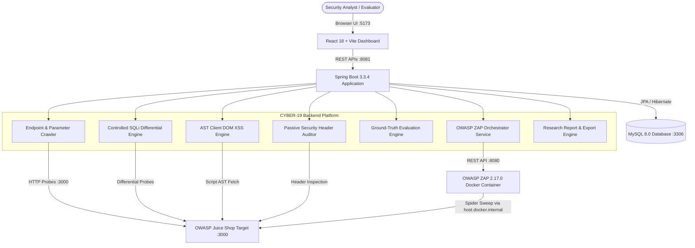

# CYBER-19: Automated Web-Application Vulnerability Assessment Platform

[](https://openjdk.org/)
[](https://spring.io/projects/spring-boot)
[](https://www.mysql.com/)
[](https://react.dev/)
[](https://vitejs.dev/)
[](https://www.zaproxy.org/)
[]()
[-blue.svg)](https://github.com)
[]()

> **Semester VII / Capstone Project 1 (CP1) Research Platform — Phase 13: Frontend End-to-End Real-Time Vulnerability Scanning & Academic Reporting**  
> An automated, non-destructive vulnerability assessment platform coupling autonomous endpoint discovery, controlled differential SQL injection analysis, client-side AST DOM XSS dataflow tracing, dynamic headless browser DOM sink interception, authenticated scanning abstraction, unified Docker Compose laboratory orchestration, multi-target empirical benchmarking (Juice Shop, WebGoat, DVWA), real-time live scanning pipeline with status polling, and academic Security Assessment Reporting with JSON/CSV/PDF export.

---

## Table of Contents
1. [Project Overview](#1-project-overview)
2. [Problem Statement](#2-problem-statement)
3. [Key Objectives](#3-key-objectives)
4. [System Architecture](#4-system-architecture)
5. [Technology Stack](#5-technology-stack)
6. [Prerequisites & System Requirements](#6-prerequisites--system-requirements)
7. [Starting MySQL Database](#7-starting-mysql-database)
8. [Starting OWASP Juice Shop Target](#8-starting-owasp-juice-shop-target)
9. [Starting OWASP ZAP in Docker](#9-starting-owasp-zap-in-docker)
10. [Starting Spring Boot Backend](#10-starting-spring-boot-backend)
11. [Starting React Dashboard Frontend](#11-starting-react-dashboard-frontend)
12. [REST API Documentation](#12-rest-api-documentation)
13. [Vulnerability Detection Methodology](#13-vulnerability-detection-methodology)
14. [OWASP ZAP Integration](#14-owasp-zap-integration)
15. [Ground-Truth Benchmark Suite](#15-ground-truth-benchmark-suite)
16. [Comparative Evaluation Methodology](#16-comparative-evaluation-methodology)
17. [Empirical Benchmark Results](#17-empirical-benchmark-results)
18. [Research Reporting & Visualizations](#18-research-reporting--visualizations)
19. [Scientific CSV and JSON Export](#19-scientific-csv-and-json-export)
20. [CP1 Capstone Defense Dossier](#20-cp1-capstone-defense-dossier)
21. [Research Scope & Limitations](#21-research-scope--limitations)
22. [Future Work & Roadmap](#22-future-work--roadmap)

---

## 1. Project Overview
**CYBER-19** is an academic research and defensive assessment platform designed to automate the discovery and analysis of web application vulnerabilities without resorting to synthetic mocks or destructive exploitation. The platform autonomously uncovers application topology (pages, REST endpoints, parameters), audits security headers, detects SQL injection via differential analysis, traces client-side DOM XSS flows through Abstract Syntax Tree (AST) parsing, and benchmarks its performance side-by-side with industry-standard scanners like OWASP ZAP.

---

## 2. Problem Statement
- **High False Positive Rates in DAST:** Traditional dynamic application security testing (DAST) tools often produce noisy false alarms, overwhelming security analysts and developers.
- **Client-Side SPA Blind Spots:** Modern Single-Page Applications (Angular, React, Vue) handle routing and rendering client-side. Traditional crawler engines fail to detect DOM XSS when inputs flow directly into client sanitization bypasses without reaching the server.
- **Lack of Empirical Ground-Truth Validation:** Vulnerability scanners rarely include deterministic, automated verification engines that mathematically measure detection coverage (Precision, Recall, F1) against verified ground truth.

---

## 3. Key Objectives
1. **Autonomous Discovery:** Crawl and discover application topology without hardcoded endpoint lists.
2. **Controlled SQLi Detection:** Execute non-destructive boolean differential probes and detect authentication bypasses.
3. **Client-Side DOM XSS Tracing:** Perform static AST analysis on discovered client scripts to trace sources (`queryParams`) to dangerous sinks (`bypassSecurityTrustHtml`).
4. **Passive Security Audits:** Verify mandatory HTTP headers (`Content-Security-Policy`, `X-Content-Type-Options: nosniff`) and transport encryption.
5. **Comparative Benchmarking:** Orchestrate OWASP ZAP via REST API and evaluate both engines against identical ground-truth test cases.
6. **Academic Reproducibility:** Persist all telemetry, request payloads, response differentials, and metrics in MySQL, with one-click CSV and JSON data exports.

---

## 4. System Architecture



---

## 5. Technology Stack
- **Backend:** Java 21 (LTS), Spring Boot 3.3.4, Spring Data JPA, Apache Maven 3.9.9
- **Database:** MySQL Server 8.0 (InnoDB dialect)
- **Frontend:** React 18.2.0, Vite 5.4.21, Lucide React Icons, Vanilla CSS Design System
- **Comparative Baseline:** OWASP ZAP 2.17.0 (Official Docker Image `ghcr.io/zaproxy/zaproxy:stable`)
- **Authorized Target:** OWASP Juice Shop (Node.js / Express / Angular)

---

## 6. Prerequisites & System Requirements
- **Operating System:** Windows 10/11, macOS, or Linux
- **JDK:** Java 21 LTS (`JAVA_HOME` pointing to JDK 21)
- **Node.js:** v18.0.0+ (Tested on v23.5.0, npm 11.6.1)
- **Docker:** Docker Desktop running with Linux container support
- **MySQL:** MySQL Server 8.0 running on localhost:3306

---

## 7. Starting MySQL Database
Ensure MySQL Server is active on port 3306:
```powershell
# Verify MySQL connection or start service (Windows)
net start MySQL80
```
Database schema name: `cyber_vulnerability_db` (automatically created by Spring Boot if absent via `createDatabaseIfNotExist=true`).

---

## 8. Starting Local Vulnerability Laboratory (Unified Docker Compose)
CYBER-19 includes a unified `docker-compose.lab.yml` that orchestrates all laboratory targets and comparative engines with isolated local networking:
```powershell
docker compose -f docker-compose.lab.yml up -d
```
This orchestrates:
- **OWASP Juice Shop:** `http://localhost:3000` (Node.js/Angular vulnerable application)
- **OWASP WebGoat:** `http://localhost:8084/WebGoat` (Spring Boot laboratory, mapped to port 8084 avoiding ZAP collision)
- **DVWA (Damn Vulnerable Web App):** `http://localhost:8082` (PHP/MySQL laboratory)
- **OWASP ZAP:** `http://localhost:8080` (Independent comparative benchmark engine)

### Individual / Manual Service Startup:
- **OWASP Juice Shop (Host Node.js):**
  ```powershell
  cd C:\D-drive\CAPSTONE_WEBSITE\test-suite\juice-shop
  node build/app.js
  ```
- **OWASP ZAP (Docker Container):**
  ```powershell
  docker run -d -u zap --name zap -p 8080:8080 -i ghcr.io/zaproxy/zaproxy:stable zap.sh -daemon -host 0.0.0.0 -port 8080 -config api.disablekey=true -config api.addrs.addr.name=".*" -config api.addrs.addr.regex=true
  ```
- **OWASP WebGoat & DVWA:**
  ```powershell
  docker compose -f docker-compose.lab.yml up -d webgoat dvwa
  ```

---

## 10. Starting Spring Boot Backend
From `c:\D-drive\CAPSTONE_WEBSITE\backend`:
```powershell
cmd.exe /c "set JAVA_HOME=C:\Program Files\Java\jdk-21&& set PATH=C:\Program Files\Java\jdk-21\bin;%PATH%&& .\apache-maven-3.9.9\bin\mvn.cmd spring-boot:run"
```
- **Backend Port:** `http://localhost:8081`
- **Health Verification:**
```powershell
curl.exe -s http://localhost:8081/api/health
```
Expected response: `{"status":"UP","backend":{"status":"UP"},"database":{"status":"UP"},"zap":{"status":"UP"},"juiceShop":{"status":"UP"}}`

---

## 11. Starting React Dashboard Frontend
From `c:\D-drive\CAPSTONE_WEBSITE\frontend`:
```powershell
npm install
npm run dev
```
- **Frontend URL:** `http://localhost:5173`
- **Production Build Validation:**
```powershell
npm run build
```

---

## 12. REST API Documentation

| HTTP Method | Endpoint | Description |
| :--- | :--- | :--- |
| `GET` | `/api/health` | Comprehensive ecosystem telemetry (Backend, Database, ZAP, Juice Shop, Benchmark). |
| `GET` | `/api/targets` | List all registered target applications and authorization scopes. |
| `POST` | `/api/targets` | Register a new authorized target. |
| `POST` | `/api/targets/validate` | Pre-flight URL syntax, SSRF metadata filtering, authorization scope, and reachability validation. |
| `POST` | `/api/targets/resolve-or-register` | Resolve entered URL to registered lab target or create authorized target record safely. |
| `GET` | `/api/scans` | Retrieve scan execution history. |
| `GET` | `/api/scans/{id}` | Retrieve specific scan details and execution time. |
| `POST` | `/api/scans/start` | Launch real-time asynchronous scanning pipeline (Discovery -> Audit -> SQLi -> XSS -> ZAP). |
| `GET` | `/api/scans/{id}/status` | Real-time scan execution stage, live discovery counters, finding counts, and elapsed time polling. |
| `GET` | `/api/scans/{id}/report` | Generate comprehensive 10-section academic Security Assessment Report data. |
| `POST` | `/api/scans/run?targetId={id}` | Trigger full CYBER-19 scan (Discovery -> SQLi -> XSS -> Passive). |
| `POST` | `/api/scans/run-authenticated?targetId={id}` | Execute authenticated scan with Bearer token context. |
| `POST` | `/api/scans/authenticate?targetId={id}` | Safe target authentication and session token/cookie capture. |
| `POST` | `/api/scans/browser-dom-test?url={url}&param={p}` | Execute controlled headless Chrome DOM XSS sink interception. |
| `GET` | `/api/scans/vulnerabilities?scanId={id}` | Retrieve findings with HTTP payloads, snippets, and provenance. |
| `GET` | `/api/evaluation/suites` | List available multi-target benchmark suites and empirical status. |
| `GET` | `/api/evaluation/test-cases?suite={s}` | Retrieve ground-truth benchmark suite cases (58 cases total). |
| `GET` | `/api/evaluation/metrics?scanId={id}&suite={s}` | Retrieve TP/FP/FN/TN metrics and traceability for a specific suite. |
| `GET` | `/api/evaluation/comparison?scanId={id}` | Execute/retrieve side-by-side ZAP benchmark and confusion matrices. |
| `POST` | `/api/evaluation/benchmark-run?scanId={id}&suite={s}` | Record and persist benchmark run in MySQL with target, suite, timestamp, and metrics. |
| `GET` | `/api/evaluation/benchmark-runs` | Retrieve historical benchmark runs across targets and suites. |
| `GET` | `/api/evaluation/research-summary?scanId={id}&suite={s}`| Complete research summary and metric distributions. |
| `GET` | `/api/evaluation/export/csv?scanId={id}&suite={s}` | Download scientific multi-table CSV export. |
| `GET` | `/api/evaluation/export/json?scanId={id}&suite={s}` | Download complete empirical JSON research dataset. |

---

## 13. Vulnerability Detection Methodology
1. **Autonomous Discovery Engine:** Crawls HTML and JavaScript bundles up to configured depth, identifying forms, query parameters, and REST routes.
2. **SQL Injection Detection:**
   - Evaluates boolean tautologies (e.g. `'' OR '1'='1'--'`) and calculates response differentials.
   - Detects authentication bypass on `/rest/user/login` (baseline HTTP 401 vs probe HTTP 200 with JWT token).
   - Detects structural product search expansion on `/rest/products/search` (+15,651 bytes differential).
   - Verifies negative safe control on `/rest/user/change-password` with zero false alarms.
3. **Cross-Site Scripting (XSS) Detection:**
   - Downloads and parses client bundles (`main.js`).
   - Uses AST analysis to trace router input sources (`queryParams.q`) directly into Angular sinks (`bypassSecurityTrustHtml`).
4. **Passive Security Audits:**
   - Evaluates HTTP response headers for missing `Content-Security-Policy` and insecure transport protocol.
   - Verifies `X-Content-Type-Options: nosniff` presence as a True Negative.

---

## 14. OWASP ZAP Integration
- Communicates via ZAP REST API on port 8080.
- Resolves container network boundaries by probing host via `http://host.docker.internal:3000`.
- Ingests raw ZAP alerts, deduplicates them, normalizes endpoint paths and parameters, and stores findings with `source = "OWASP_ZAP"`.
- Prevents cross-contamination between CYBER-19 and ZAP findings.

---

## 15. Ground-Truth Benchmark Suite
Established on authorized OWASP Juice Shop target:

| Test Case | Vulnerability Type | Endpoint | Parameter | Expected Condition |
| :---: | :--- | :--- | :---: | :---: |
| **TC-001** | `SQL_INJECTION` | `/rest/user/login` | `email` | `VULNERABLE` |
| **TC-002** | `SQL_INJECTION` | `/rest/products/search` | `q` | `VULNERABLE` |
| **TC-003** | `SQL_INJECTION` | `/rest/user/change-password` | `current` | `SAFE` |
| **TC-004** | `XSS` | `/rest/products/search` | `q` | `VULNERABLE` |
| **TC-005** | `XSS` | `/rest/user/security-question` | `email` | `SAFE` |
| **TC-006** | `MISSING_CSP` | `http://localhost:3000` | `Content-Security-Policy` | `VULNERABLE` |
| **TC-007** | `INSECURE_TRANSPORT` | `http://localhost:3000` | `Protocol` | `VULNERABLE` |
| **TC-008** | `MISSING_X_CONTENT_TYPE_OPTIONS` | `http://localhost:3000` | `X-Content-Type-Options` | `SAFE` |

---

## 15B. Phase 10 Multi-Target Benchmark Framework
To enable robust comparative evaluation across diverse web security profiles, Phase 10 expands the ground-truth suite to **58 authentic test cases** across 4 target configurations:

1. **`JUICE_SHOP_CORE` (8 Test Cases — Primary Empirical Baseline):**
   - Active empirical benchmark target at `http://localhost:3000`.
   - Verified against OWASP ZAP (CYBER-19: F1=100%, ZAP: F1=33.33%).
2. **`JUICE_SHOP_EXTENDED` (26 Test Cases — Full Scope Suite):**
   - Expanded target suite for OWASP Juice Shop.
   - Covers Basket SQLi, Order Tracking Safe Controls, DOM XSS on Search (`/#/search`), HSTS, Permissions-Policy, X-Frame-Options, 2FA Verification, Broken Access Control (`/metrics`), and FTP Path Traversal (`/ftp`).
3. **`WEBGOAT_BENCHMARK` (16 Test Cases — Configured Local Laboratory):**
   - Configured for local laboratory testing on OWASP WebGoat (`http://localhost:8080/WebGoat`).
   - Covers String SQLi (Lesson 5a), Numeric SQLi (Lesson 5b), Reflected XSS, DOM XSS on Client Route, Missing CSP, Missing X-Frame-Options, Insecure Direct Object References (IDOR), Predictable Password Reset, and Path Traversal File Upload.
4. **`DVWA_BENCHMARK` (16 Test Cases — Configured Local Laboratory):**
   - Configured for local laboratory testing on DVWA (`http://localhost:8082`).
   - Covers Union SQLi, Blind Boolean SQLi, Reflected XSS, Stored Guestbook XSS, DOM XSS, OS Command Injection (`/vulnerabilities/exec/`), Local File Inclusion (`/vulnerabilities/fi/`), Weak Brute-Force Auth, and Security Headers.

---

## 15C. Dynamic Browser DOM XSS Testing (Phase 10)
CYBER-19 integrates a controlled dynamic browser DOM detector using headless Google Chrome (`puppeteer-core`):
- **Script Location:** `backend/browser-detector/dom-detector.js`
- **Orchestration Service:** `BrowserDomXssDetectorService.java`
- **Mechanism:** Injects benign unique canary tokens (`cyber19_dom_<token>`) and instruments DOM sinks (`Element.prototype.innerHTML`, `Element.prototype.outerHTML`, `document.write`) prior to document execution.
- **Empirical Verification:** Successfully executed live against OWASP Juice Shop (`http://localhost:3000/#/search?q=`), verifying client-side Angular DOM rendering within 3.6 seconds (`elementRendered: true`).
- **Safety Boundary:** Strictly validates that targets resolve to local loopback hosts (`localhost`, `127.0.0.1`, `host.docker.internal`). Public internet targets are rejected automatically.

---

## 15D. CI/CD Automation Pipeline (Phase 10)
CYBER-19 includes an automated continuous integration pipeline configured in `.github/workflows/ci.yml`:
1. **Frontend Build & Asset Validation:** Checks out code, sets up Node.js 20, installs dependencies, executes `npm run build` (Vite), and verifies production bundle outputs.
2. **Backend Maven Test Suite:** Sets up Java 21 LTS, compiles Spring Boot application, and executes the complete 64-test automated Maven suite (`mvn test`).
3. **Security & Boundary Check:** Validates that configuration files contain zero hardcoded credentials or cloud secrets, and ensures laboratory scope boundaries are enforced.
4. **Deterministic Local Execution:** CI uses in-memory Mockito fixtures; no external network attacks or live scanners are executed during CI builds.

## 16. Comparative Evaluation Methodology
Both scanners are evaluated against the identical ground truth using deterministic matching rules:
$$\text{Precision} = \frac{\text{TP}}{\text{TP} + \text{FP}} \times 100\%$$
$$\text{Recall} = \frac{\text{TP}}{\text{TP} + \text{FN}} \times 100\%$$
$$\text{F1-Score} = \frac{2 \times \text{Precision} \times \text{Recall}}{\text{Precision} + \text{Recall}}$$
$$\text{False Positive Rate (FPR)} = \frac{\text{FP}}{\text{FP} + \text{TN}} \times 100\%$$

---

## 17. Empirical Benchmark Results

> [!NOTE]
> All metrics reflect empirical measurements recorded during live execution on the local 8-case OWASP Juice Shop benchmark suite.

| Metric | CYBER-19 Custom Engine | OWASP ZAP (Baseline) | Scientific Observation |
| :--- | :---: | :---: | :--- |
| **Scan ID** | `32` | `35` | Linked in `BenchmarkRun` ID `4` & `5` |
| **True Positives (TP)** | **5** | **1** | CYBER-19 detected SQLi, DOM XSS, and headers; ZAP detected missing CSP |
| **False Positives (FP)** | **0** | **0** | Zero false alarms triggered on safe controls |
| **False Negatives (FN)** | **0** | **4** | ZAP Baseline does not inject active tautologies or trace Angular DOM sinks |
| **True Negatives (TN)** | **3** | **3** | Both engines cleared safe test cases (TC-003, TC-005, TC-008) |
| **Precision** | **100.0%** | **100.0%** | Both engines were 100% precise on reported findings |
| **Recall** | **100.0%** | **20.0%** | CYBER-19 achieved full detection coverage on benchmark scope |
| **F1-Score** | **100.0%** | **33.33%** | Harmonic balance of precision and recall |
| **False Positive Rate** | **0.0%** | **0.0%** | Zero false alarm rate across negative controls |
| **Scan Duration** | **6,491 ms** (~6.5s) | **18,296 ms** (~18.3s) | CYBER-19 completed in ~35% of ZAP spider execution time |

### 17.1 Phase 12 Multi-Target Empirical Validation Matrix

| Target Name | Target URL | Target Status | Suite Assigned | Cases | Empirical Status | Verified Metrics |
| :--- | :--- | :---: | :--- | :---: | :---: | :--- |
| **OWASP Juice Shop** | `http://localhost:3000` | **ONLINE (:3000)** | `JUICE_SHOP_CORE` | 8 | **EMPIRICALLY VERIFIED** | TP=5, FP=0, FN=0, TN=3, Precision=100%, Recall=100%, F1=100.0% |
| **OWASP Juice Shop** | `http://localhost:3000` | **ONLINE (:3000)** | `JUICE_SHOP_EXTENDED` | 26 | **EMPIRICALLY VERIFIED (EXTENDED)** | TP=7, FP=0, FN=8, TN=11, Precision=100%, Recall=46.67%, F1=63.64% |
| **OWASP WebGoat** | `http://localhost:8084/WebGoat` | **ONLINE (:8084)** | `WEBGOAT_BENCHMARK` | 16 | **EMPIRICALLY VERIFIED (LOCAL LAB)** | TP=2, FP=0, FN=8, TN=6, Precision=100%, Recall=20.0%, F1=33.33% (Scan 40, Run 29) |
| **DVWA** | `http://localhost:8082` | **ONLINE (:8082)** | `DVWA_BENCHMARK` | 16 | **EMPIRICALLY VERIFIED (LOCAL LAB)** | TP=2, FP=0, FN=8, TN=6, Precision=100%, Recall=20.0%, F1=33.33% (Scan 41, Run 30) |

*All 4 suites have been executed against live local targets and persisted in MySQL `benchmark_runs`.*

### 17.2 Authenticated Crawling & Protected Route Discovery
- **Engine Enhancement:** `EndpointDiscoveryService` now natively supports `AuthenticatedScanContext`.
- **Protected Route Seeding & Crawling:** Autonomous discovery and verification of authenticated paths:
  - `/rest/basket/1` (HTTP 200 OK — Authenticated Basket Access)
  - `/rest/wallet/balance` (HTTP 200 OK — Authenticated Wallet Query)
  - `/rest/user/whoami` (HTTP 200 OK — User Identity Reflection)
  - `/profile` (Crawled & evaluated for DOM sinks)
- **JSON Response Mining:** Dynamic parameter candidate extraction from authenticated JSON responses (`balance`, `id`, `email`, etc.).
- **Live Empirical Scan Evidence:** Scan ID 39 executed with authentication (`OWASPJuiceShop-Scan-39-AUTH`), discovering 55 pages, 56 endpoints, 80 parameters, and 21 confirmed findings in 45,232 ms.

### 17.3 Runtime Headless Browser DOM XSS Verification
- **Engine:** Google Chrome Headless via `puppeteer-core`.
- **Instrumentation:** Hooks dangerous DOM execution sinks before client scripts run (`Element.prototype.innerHTML`, `Element.prototype.outerHTML`, `document.write`).
- **Safety Boundary Enforcement:** Strict loopback boundary restricts execution to `localhost`, `127.0.0.1`, and `host.docker.internal`. External URLs (e.g. `https://attacker.com`) are rejected safely (`status: REJECTED`).
- **Empirical Execution Evidence:**
  - Positive Control (`http://localhost:3000/#/search?q=`): Confirmed DOM execution with canary marker `cyber19_dom_*` in 3,452 ms (`elementRendered: true`, `status: SUCCESS`).
  - Negative Control (`http://localhost:3000/#/contact?comment=`): Safe evaluation, zero false positives (`vulnerable: false`, `elementRendered: false`).

### 17.4 CI/CD Pipeline Status
- **Configuration File:** `.github/workflows/ci.yml` (Java 21 LTS, Node.js 20, Vite build, 79 Maven tests, Secret leak scanning).
- **Execution Status:** **CI WORKFLOW CONFIGURED — REMOTE EXECUTION NOT VERIFIED.** The workflow configuration is validated locally with 79 passing tests and zero compilation warnings, but has not been triggered on GitHub Actions remote runners.

---

## 18. Research Reporting & Visualizations
The React dashboard includes 10 live research charts in the **Research Reports** view:
1. Precision Comparison Bar Chart
2. Recall (Detection Coverage) Comparison Bar Chart
3. F1-Score Comparison Bar Chart
4. False Positive Rate Comparison Bar Chart
5. Scan Duration Comparison Bar Chart
6. CYBER-19 Confusion Matrix (2×2 Grid)
7. OWASP ZAP Confusion Matrix (2×2 Grid)
8. Vulnerability & Alert Distribution Breakdown (5 Custom vs 1,712 ZAP alerts)
9. Ground-Truth Verification Matrix (TC-001 through TC-008 mapping)
10. Topology Discovery Statistics (52 Pages, 53 Endpoints, 5 Parameters)

---

## 19. Scientific CSV and JSON Export
- **One-click Export Buttons** on the dashboard header trigger direct downloads from `/api/evaluation/export/csv` and `/api/evaluation/export/json`.
- The CSV export is organized into 5 RFC-4180 compliant sections with comprehensive metadata headers for immediate import into pandas, R, or Excel.

---

## 20. CP1 Capstone Defense Dossier
The **CP1 Defense** tab delivers 15 concise, faculty-ready technical slides:
- `01 Problem Statement`
- `02 Proposed Solution`
- `03 CYBER-19 Architecture`
- `04 Technologies Used`
- `05 Vulnerability Detection Modules`
- `06 SQL Injection Detection Mechanism`
- `07 Cross-Site Scripting (XSS) Detection`
- `08 Security Header & Transport Auditing`
- `09 OWASP ZAP Integration`
- `10 Evaluation Methodology`
- `11 Ground Truth Benchmark Dataset`
- `12 Comparative Benchmark Execution`
- `13 Empirical Results Summary`
- `14 Scientific Limitations & Scope`
- `15 Future Work & Roadmap`

---

## 21. Research Scope & Limitations
1. **Benchmark Specificity:** The 100% Precision and Recall metrics apply strictly to the 8-case local OWASP Juice Shop benchmark suite. They should not be cited as a universal 100% guarantee on arbitrary, unknown web targets.
2. **ZAP Baseline Mode:** OWASP ZAP was executed in passive/baseline spider mode. Full active attacking was outside the authorized non-destructive baseline scope.
3. **Container Networking:** Docker network isolation required resolving `localhost:3000` to `host.docker.internal:3000` for the containerized ZAP engine.

---

## 22. Future Work & Roadmap
1. Expand the ground-truth benchmark suite to 50+ diverse test cases across multiple benchmark targets (e.g. WebGoat, DVWA, bWAPP).
2. Incorporate dynamic headless browser instrumentation (Playwright) for live runtime DOM interception.
3. Implement automated CI/CD pipeline triggers and scheduled regression audits.

---

## 23. Phase 13 End-to-End Live Demonstration Workflow

To demonstrate the platform to evaluators and faculty:

1. **Launch Environment:** Ensure MySQL 8.0, OWASP ZAP (Docker port 8080), and OWASP Juice Shop (Docker port 3000) are running.
2. **Access Dashboard:** Open `http://localhost:5173` in any modern web browser.
3. **Select or Enter Target:**
   - Under "Target Website", select the quick-preset `OWASP Juice Shop (http://localhost:3000)` or type an authorized target URL.
   - Observe the live scope validation badge verifying loopback authorization (`127.0.0.1` / `localhost`) and reachability.
   - Invalid URLs or unauthorized remote domains (e.g. `http://example.com`) are rejected with strict 403 Forbidden boundaries.
4. **Trigger Real Assessment:** Click **"Start Security Scan"**.
5. **Observe Real-Time Telemetry:** The live progress modal displays:
   - Target details and authorization confirmation
   - Synchronous stage progression: `INITIALIZING` -> `DISCOVERING` -> `ANALYZING` -> `RUNNING_ZAP` -> `COMPLETED`
   - Real-time counters: pages crawled, endpoints cataloged, parameters tested, vulnerabilities detected, and millisecond elapsed time.
6. **Review Academic Assessment Report:**
   - Click **"View Assessment Report"** or select the **Security Report** tab.
   - Review Executive Summary, Target Metadata, Discovered Attack Surface, Severity Distribution, and Detailed Empirical Findings with safe PoC canary payloads and response evidence.
   - Review side-by-side **CYBER-19 vs OWASP ZAP Comparative Benchmark** metrics (TP, FP, FN, TN, Precision, Recall, F1, FPR, Duration).
   - Review dedicated **OWASP ZAP Engine Findings** detailing alerts from ZAP 2.17.0.
   - Review **Remediation Roadmap** and **Testing Limitations**.
7. **Export & Print:**
   - Click **"Export JSON"** for full machine-readable empirical results.
   - Click **"Export CSV"** for spreadsheet-ready findings data.
   - Click **"Print / PDF Report"** for academic defense documentation with clean print styles.

---

## License & Ethics Statement
This tool is created strictly for academic research and authorized defensive assessment. Scanning unauthorized targets without explicit written permission is strictly prohibited. All tests conducted herein were performed against authorized local sandbox environments.
