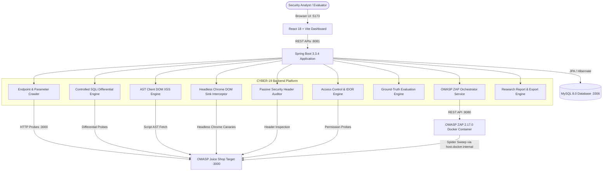

# CYBER-19: Automated Web-Application Vulnerability Assessment Platform

[](https://openjdk.org/)
[](https://spring.io/projects/spring-boot)
[](https://www.mysql.com/)
[](https://react.dev/)
[](https://vitejs.dev/)
[](https://www.zaproxy.org/)
[]()
[]()
[]()

> **CYBER-19** is an academic research and defensive assessment platform designed to automate web application vulnerability discovery and benchmarking without synthetic mocks or destructive exploitation.
> It couples **autonomous attack surface discovery**, **controlled boolean differential SQL injection analysis**, **client-side AST DOM XSS dataflow tracing**, **dynamic headless Chrome DOM sink interception**, **automated access control & IDOR checks**, **13-category remediation guidance**, and **comparative empirical benchmarking against OWASP ZAP 2.17.0** across 58 ground-truth test cases.

---

## 📚 Essential Team Documentation

For teammates setting up, exploring, or contributing to the project, start with these guides:

| Document | Purpose | Audience |
| :--- | :--- | :--- |
| 🚀 [**TEAMMATE_SETUP.md**](./TEAMMATE_SETUP.md) | **Step-by-step setup guide for fresh Windows laptops** (software checklist, Docker lab startup, MySQL setup, backend & frontend startup, troubleshooting). | Teammates cloning the project |
| 🏛️ [**PROJECT_OVERVIEW.md**](./PROJECT_OVERVIEW.md) | **Deep-dive architecture & engineering specification** (system tiers, Mermaid diagrams, data flows, database entity model, 17-phase history). | Evaluators, defense reviewers & developers |
| 🤝 [**CONTRIBUTING.md**](./CONTRIBUTING.md) | **Git branching, testing & PR contribution guidelines** (feature branches, test commands, commit style, merge conflict resolution). | Teammates submitting changes |

---

## ⚡ Quick-Start (Local Execution)

For detailed step-by-step instructions, follow [`TEAMMATE_SETUP.md`](./TEAMMATE_SETUP.md).

```powershell
# 1. Clone repository & configure environment
git clone https://github.com/SHAIKZILANI/CYBER-19.git
cd CYBER-19
Copy-Item .env.example .env

# 2. Start Docker security lab (ZAP :8080, Juice Shop :3000, WebGoat :8084, DVWA :8082)
docker compose -f docker-compose.lab.yml up -d

# 3. Check & Start MySQL 8 (if not already running natively on port 3306)
# Pre-check: Test-NetConnection -Port 3306 -ComputerName localhost
# If port 3306 is not listening, run MySQL via Docker:
# docker run -d --name cyber19-mysql -p 3306:3306 -e MYSQL_ROOT_PASSWORD=root -e MYSQL_DATABASE=cyber_vulnerability_db mysql:8.0

# 4. Start Spring Boot backend (Terminal 2)
cd backend
$env:JAVA_HOME = "C:\Program Files\Java\jdk-21"
.\mvnw.cmd spring-boot:run
# Backend API: http://localhost:8081 | Health: http://localhost:8081/api/health

# 5. Start React frontend dashboard (Terminal 3)
cd frontend
npm install
npm run dev
# Frontend Dashboard: http://localhost:5173
```

---

## 🛡️ Authorized Testing & Scope Warning

> [!WARNING]
> **CYBER-19 is built exclusively for authorized academic research and defensive assessment.**
> Probing unauthorized, third-party targets without explicit written authorization is illegal.
> The platform includes built-in defensive gatekeepers (`TargetScopeValidator`):
> - **Server-Side Request Forgery (SSRF) Defense:** Probing cloud metadata endpoints (`169.254.169.254`, `metadata.google.internal`) is strictly blocked.
> - **Port Isolation:** Sensitive local system ports (`3306`, `22`, `445`, `3389`) cannot be scanned.
> - **Authorization Confirmation:** Any non-laboratory target requires explicit confirmation (`authorized: true`) before scan initialization.

---

## 🔍 Key Implemented Features

### 1. Autonomous Attack Surface Discovery
- Multi-level recursive crawling powered by `jsoup`.
- Extracts HTML hyperlinks, form actions, GET/POST parameter names, and REST routes.
- Proactively seeds and evaluates authenticated paths (`/rest/basket/1`, `/rest/wallet/balance`, `/profile`).

### 2. Controlled Differential SQL Injection Detection
- Evaluates non-destructive boolean tautologies (e.g. `' OR '1'='1'--`).
- Detects authentication bypass on `/rest/user/login` (baseline HTTP 401 vs probe HTTP 200 with JWT token).
- Detects structural database expansion on `/rest/products/search` (+15,651 bytes differential).
- Confirms negative safe controls on `/rest/user/change-password` with zero false alarms.

### 3. Client-Side AST & Dynamic Headless Chrome DOM XSS Detection
- Parses client JavaScript bundles (`main.js`) using Abstract Syntax Tree (AST) analysis to trace input sources (`queryParams.q`) directly into Angular sinks (`bypassSecurityTrustHtml`).
- Instruments runtime Google Chrome DOM sinks (`innerHTML`, `outerHTML`, `document.write`) via `puppeteer-core` with unique benign canary tokens (`cyber19_dom_<token>`).

### 4. Passive Security Posture Audits
- Audits HTTP headers for missing `Content-Security-Policy`, missing `X-Content-Type-Options: nosniff`, missing `Strict-Transport-Security`, and insecure cleartext transport.

### 5. Access Control & IDOR Assessment
- Identifies unauthenticated exposure of administrative and telemetry endpoints (`/metrics` Prometheus metrics leak).
- Assesses Direct Object Reference controls without generating false positives on SPA index fallbacks.

### 6. Actionable Remediation Guidance Engine
- Automatically correlates detected findings with structured remediation guidance across 13 vulnerability categories.
- Provides specific CWE IDs (e.g. CWE-89, CWE-79, CWE-284), architectural impacts, code-level developer fixes, and OWASP references.

### 7. Dual Scanner Empirical Benchmarking
- Containerized OWASP ZAP 2.17.0 integration via REST API.
- Normalizes ZAP alerts and evaluates both engines against identical ground-truth test cases.
- Computes mathematical confusion matrices (True Positives, False Positives, False Negatives, True Negatives, Precision, Recall, F1-Score, FPR).

### 8. Academic Reporting & Data Export
- 10-section academic Security Assessment Report viewable in the dashboard.
- 10 interactive research visualization charts in the **Research Reports** view.
- One-click RFC-4180 CSV and JSON scientific dataset export.
- 15-slide **CP1 Defense Dossier** integrated directly into the web UI for faculty evaluation.

---

## 🏗️ System Architecture



---

## 📊 Empirical Ground-Truth Benchmark Results

| Suite Identifier | Target Application | Test Cases | Lab Port | Empirical Status | TP | FP | FN | TN | Precision | Recall | F1-Score |
| :--- | :--- | :---: | :---: | :--- | :---: | :---: | :---: | :---: | :---: | :---: | :---: |
| `JUICE_SHOP_CORE` | OWASP Juice Shop | 8 | `3000` | **EMPIRICALLY VERIFIED** | 5 | 0 | 0 | 3 | 100.0% | 100.0% | **100.0%** |
| `JUICE_SHOP_EXTENDED` | OWASP Juice Shop | 26 | `3000` | **EMPIRICALLY VERIFIED (EXTENDED)** | 7 | 0 | 8 | 11 | 100.0% | 46.67% | **63.64%** |
| `WEBGOAT_BENCHMARK` | OWASP WebGoat | 16 | `8084` | **EMPIRICALLY VERIFIED (LOCAL LAB)** | 2 | 0 | 8 | 6 | 100.0% | 20.0% | **33.33%** |
| `DVWA_BENCHMARK` | DVWA | 16 | `8082` | **EMPIRICALLY VERIFIED (LOCAL LAB)** | 2 | 0 | 8 | 6 | 100.0% | 20.0% | **33.33%** |

---

## 🔌 Verified REST API Endpoints

| Method | Endpoint | Description |
| :--- | :--- | :--- |
| `GET` | `/api/health` | Comprehensive ecosystem telemetry (Backend, Database, ZAP, Juice Shop). |
| `GET` | `/api/targets` | List all registered target applications and authorization scopes. |
| `POST` | `/api/targets` | Register a new authorized target. |
| `POST` | `/api/targets/validate` | Pre-flight URL syntax, SSRF metadata filtering, authorization scope, and reachability. |
| `POST` | `/api/targets/resolve-or-register` | Resolve entered URL to registered lab target or create authorized record safely. |
| `GET` | `/api/scans` | Retrieve historical scans with status and execution timing. |
| `POST` | `/api/scans/start` | Launch real-time asynchronous scanning pipeline (Discovery -> Audit -> SQLi -> XSS -> Access Control -> ZAP). |
| `GET` | `/api/scans/{id}/status` | Real-time scan execution stage, live discovery counters, finding counts, and elapsed time polling. |
| `GET` | `/api/scans/{id}/report` | Generate comprehensive 10-section academic Security Assessment Report data. |
| `GET` | `/api/scans/{id}/vulnerabilities` | Retrieve findings with HTTP payloads, response snippets, and provenance (supports pagination). |
| `GET` | `/api/evaluation/suites` | List available multi-target benchmark suites and empirical statuses. |
| `GET` | `/api/evaluation/test-cases?suite={s}` | Retrieve ground-truth benchmark suite cases (58 cases total). |
| `GET` | `/api/evaluation/metrics?scanId={id}&suite={s}` | Retrieve TP/FP/FN/TN metrics and traceability for a specific suite. |
| `GET` | `/api/evaluation/comparison?scanId={id}` | Execute or retrieve side-by-side ZAP benchmark and confusion matrices. |
| `GET` | `/api/evaluation/export/csv?scanId={id}&suite={s}` | Download scientific multi-table CSV dataset. |
| `GET` | `/api/evaluation/export/json?scanId={id}&suite={s}` | Download complete empirical JSON research dataset. |

---

## ⚠️ Known Limitations

1. **Benchmark Specificity:** The 100% Precision and Recall metrics apply strictly to the 8-case local OWASP Juice Shop benchmark suite (`JUICE_SHOP_CORE`). They do not represent a universal 100% guarantee across arbitrary internet targets.
2. **Non-Destructive Baseline Mode:** OWASP ZAP was executed in passive/baseline spider mode to ensure non-destructive comparability. Aggressive active fuzzing attack rules were omitted.
3. **Headless Chrome Safety Boundary:** Dynamic browser DOM sink inspection is strictly restricted to loopback laboratory targets (`localhost`, `127.0.0.1`, `host.docker.internal`).

---

## 📄 License & Academic Ethics

This project is developed solely for academic demonstration and authorized defensive research. Scanning targets without explicit authorization is strictly prohibited. All experimental evaluations were performed within isolated, locally hosted containerized environments.
